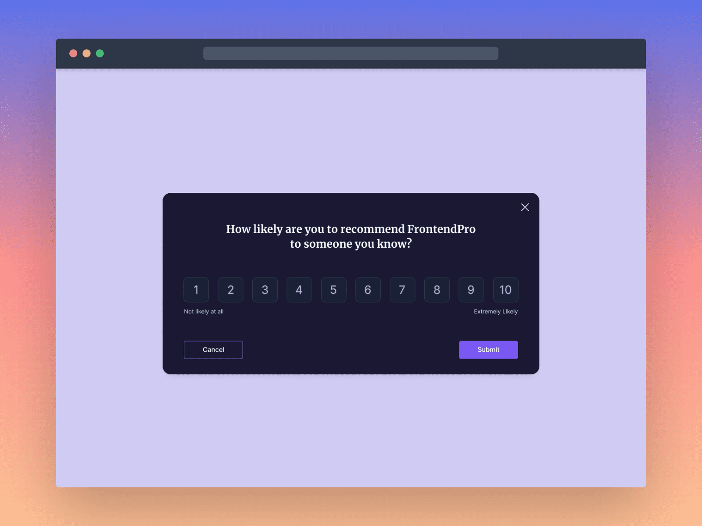

# Feedback Modal Component



A responsive feedback modal built with HTML, CSS, and JavaScript. Users open the modal with a button, rate a product from 1 to 10, and submit or cancel their feedback.

This is my solution to the Feedback Modal Component challenge from [Frontend Pro](https://twitter.com/FrontendProHQ).

## Table of Contents

- [Overview](#overview)
- [Features](#features)
- [Built With](#built-with)
- [What I Learned](#what-i-learned)
- [Getting Started](#getting-started)
- [Project Structure](#project-structure)
- [Links](#links)
- [Author](#author)

## Overview

**Challenge:** Feedback Modal Component
**Difficulty:** Beginner
**Tag:** Frontend

The goal of the challenge is to practice building interactive UI components with CSS and JavaScript, using flexbox for responsive layouts and handling open/close behavior for a modal, while matching the provided design as closely as possible.

## Features

- A button triggers the modal, which appears as an overlay on top of the page.
- A rating scale from 1 to 10, where users select a rating by clicking a number.
- The selected rating is visually highlighted.
- The modal closes when feedback is submitted.
- The modal closes when the user clicks the "Cancel" button.
- The modal closes when the user clicks outside of it.
- Fully responsive layout that works across desktop, tablet, and mobile screens.

## Built With

- Semantic HTML5
- CSS3 (Flexbox, custom properties)
- Vanilla JavaScript (DOM manipulation, event handling)

## What I Learned

- Building a modal overlay and controlling its visibility with JavaScript.
- Closing a modal by clicking outside of it using event handling on the backdrop.
- Creating a clickable rating scale and tracking the selected value.
- Using flexbox to build a layout that adapts to different screen sizes.

## Getting Started

### Prerequisites

A modern web browser. No build tools or dependencies are required.

### Run Locally

1. Clone the repository:

   ```bash
   git clone https://github.com/Hemarnuel10/<repository-name>.git
   ```

2. Navigate into the project folder:

   ```bash
   cd <repository-name>
   ```

3. Open `index.html` in your browser, or serve it with a local server such as the VS Code Live Server extension.

## Project Structure

```
.
feedback-modal-component/
├── design/
│   ├── desktop-active.png
│   ├── desktop-cover.png
│   ├── desktop.png
│   └── Feedback Modal Component.fig
├── src/
│   ├── script.js
│   └── style.css
├── index.html
└── README.md
```

## Links

- Live Site: [your-live-site-url](https://hemarnuel10.github.io/Feedback-Modal-Component/)
- Solution Repository: [your-repository-url](https://github.com/Hemarnuel10/Feedback-Modal-Component.git)

## Author

**Hemarnuel**

- GitHub: [@Hemarnuel10](https://github.com/Hemarnuel10)
